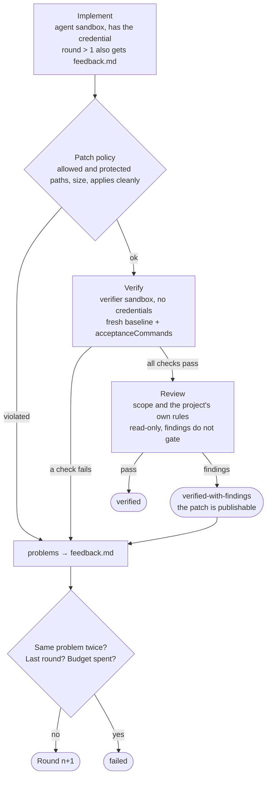

# Sprowi · your startup companion

Sprowi turns a task document into a verified patch and, on request, a draft pull
request. It works on any project in `projects.yaml`, runs the agent inside a
Docker Sandbox microVM, and verifies the result in a second sandbox that has no
credentials at all.

It descends from DevBoost's SoftwareGoblin. What was left out on purpose: the
Slack bridge, the GitHub Actions workflow, the credential proxy (`sbx` does that
now) and the task-document translation step. What was added: four engines, a
hub-central harness, and a `check` verb.

## Where things live

The hub owns the loop. Project repositories stay free of agent plumbing — no
`.agent-loop/` directory, no scripts, nothing to keep in sync across eight
repositories.

```
sprowi/
  cli.mjs                  the CLI behind scripts/sprowi.sh
  config.default.json      defaults: engines, limits, path policy
  projects/<name>.json     per project: setupCommands and acceptanceCommands
  projects/<name>.review.md  optional, overrides review.default.md
  tasks/<name>/NNN-slug/   task.md, optional acceptance-tests.md and loop.md
  runs/<name>/<timestamp>/ result.json, result.patch, usage.json, engine events
  sandbox/                 sbxenv files and kits, one per engine
  run-local.mjs            the round loop (host)
  run-agent.mjs            one engine call (inside the agent sandbox)
  run-commands.mjs         setup and acceptance commands (inside a sandbox)
  publish.mjs              branch, push, draft PR (host, after the sandbox is gone)
```

## One-time setup

`scripts/init.sh --with-sprowi` walks through all of it: it checks `docker`, `sbx`
and `mise`, offers to sign `sbx` in, then lists every engine credential and
offers to import the missing ones from the Passwords app — the default engine
first, and it stops after the first success, because one credential is enough.
Sprowi is beta, so the plain `scripts/init.sh` leaves the whole phase out and says
so.

**On another machine that is the entire setup.** The canonical values live in
Passwords under exactly the Keychain service names below, the same convention
the vault passwords follow, so a second machine imports them instead of minting
new tokens.

By hand, it is three steps:

1. Docker Desktop 4.58 or newer, plus a current `sbx` with `--skills=off`
   support (`sbx create --help`). Old builds such as 0.42.1 cannot parse the
   required isolation setting; `doctor` and the loop refuse them before creating
   a VM. Update with `brew upgrade --cask docker/tap/sbx` rather than removing
   `sandboxOptions.skills: off` from the checked-in definitions:

   ```bash
   sbx login && sbx policy init balanced
   ```

2. The credential for the engine you want. It is stored in the macOS Keychain
   and read by `sbx` **on the host**: the sandbox only ever sees a placeholder,
   and the host proxy swaps it into the outbound request. `-w` as the last
   option prompts for the value, so it never reaches the shell history; `-T ""`
   trusts no application, so every read shows a macOS dialog.

   | Engine | Keychain service | What to put in it |
   |---|---|---|
   | `claude` | `SPROWI_CLAUDE` | the token from `claude setup-token` (bills your subscription) |
   | `codex` | — | nothing to store: it reads the ChatGPT subscription token from `~/.codex/auth.json`, so run `codex` once and sign in |
   | `opencode` | `SPROWI_OPENROUTER` | an OpenRouter API key |
   | `copilot` | `SPROWI_COPILOT` | a fine-grained PAT whose only permission is Copilot Requests |

   ```bash
   claude setup-token                                            # prints the token
   security add-generic-password -U -a "$USER" -s SPROWI_CLAUDE -T "" -w
   ```

   Keep the canonical value in the Passwords app under the same name, exactly
   as the vault passwords are kept: the Keychain entry is the local copy that
   `sbx` reads, and a new machine should restore the token rather than mint a
   second one.

   Do not export engine credentials into every shell. Let the sandbox resolve
   them on the host only when needed.

   To read the credential from somewhere else instead, set `SPROWI_SECRET_COMMAND`
   to a host command that prints it, for example
   `op read op://Private/Anthropic/token`.

3. Check the machine:

   ```bash
   scripts/sprowi.sh doctor --engine claude
   ```

## Teaching Sprowi a project

```bash
scripts/sprowi.sh init example-app     # writes sprowi/projects/example-app.json
scripts/sprowi.sh check example-app    # do those commands pass on an untouched checkout?
```

`init` asks the project's own `mise tasks`, keeps the ones ending in `lint`,
`test` or `build`, skips `deployment:*`, and adds `mise install` plus one
package-manager install per lockfile. A generated entry reads:

```json
"backend-lint": ["mise", "run", "backend:lint"]
```

**Why mise and not the `make.sh` verbs directly.** A mise task carries two
things the loop would otherwise have to guess: the directory it runs in, and
the runtime the project pins. Without it the checks run against whatever node
the sandbox image happens to ship rather than the version in the project's
`mise.toml` — a wrong test bench, not just an ugly command. mise is not in the
sandbox images, so `sprowi/sandbox/kits/mise` installs it into every sandbox,
from npm rather than the official installer, because that one downloads its
binary from `github.com` and every Sprowi kit denies that host.

**Run `check` before the first real run.** `acceptanceCommands` is the only
thing that decides whether a patch is "verified", and a command that already
fails on an untouched checkout burns a full round on something the agent did
not cause.

Everything not listed in `acceptanceCommands` is invisible to the loop.

## Running

### Testing a startup idea

The first vertical slice keeps the decision separate from the implementation.
Select one Markdown idea from `ideas/` (or a local copy of an idea still in a
pull request):

```bash
scripts/sprowi.sh select ideas/001-link-analytics.md link-analytics
```

This copies the idea to `sprowi/experiments/link-analytics/` and creates
`experiment.json` and `observation.json`. Complete the experiment before
building: hypothesis, target audience, a concrete distribution route, one
observable action, its data source, minimum sample, success/failure thresholds,
and measurement window. `unit` is `count` or `ratio`; ratio thresholds use
fractions from 0 to 1. Leave the window dates empty until a test launch is
scheduled. A page view can be an action, but a signup or repeated use usually
tests a stronger claim. Record test traffic separately so it is not counted.

Once the startup has been created and registered, turn the experiment into a
Sprowi task. This refuses an incomplete plan and places the measurement contract
in the task the agent receives:

```bash
scripts/sprowi.sh new <project> <slug> --experiment link-analytics
scripts/sprowi.sh run <project> <task> --publish
```

The reviewed patch is then deployed through the normal `startup` workflow on
the host. Sprowi's sandbox cannot deploy. The implementation must make the KPI
action observable in the app's existing database or an analytics export. This
slice does not add a central tracking service or automatically publish posts.

After the window, put the action count, sample size, observation date and data
source (query, export or report URL) into `observation.json`, then run:

```bash
scripts/sprowi.sh evaluate link-analytics
```

The deterministic result is `supported`, `rejected` or `inconclusive`.
Incomplete plans or observations and windows still in progress never count as
success. These are experiment outcomes, not proof of a viable business. Reach
and distribution are part of the plan because a product without test users
cannot be evaluated. Future distribution automation can consume that field,
but publishing to outside channels needs its own integration and workflow.
If the result is weak, use the observed drop-off to form the next task and
measure another window. Keep the original thresholds and observation as a
record; do not rewrite them after seeing the result.

```bash
scripts/sprowi.sh new example-app bike-shop        # scaffolds sprowi/tasks/example-app/002-bike-shop/
$EDITOR sprowi/tasks/example-app/002-bike-shop/task.md
scripts/sprowi.sh run example-app 002-bike-shop
scripts/sprowi.sh run example-app 002-bike-shop --engine codex --rounds 2 --publish
```

`--model` overrides the engine's model for one run. The committed default is
Haiku, which is the right default for cost but not for every task: the same
idea brief on Haiku produces thinner results than on Sonnet. Reach for the
bigger model when the task needs judgement rather than mechanics.

```bash
scripts/sprowi.sh run startup-factory 002-next-round --model claude-sonnet-5-5
```

`task.md` is the only required document. `acceptance-tests.md` (GIVEN / WHEN /
THEN scenarios) and `loop.md` (guidance for this one task) are optional, which
is what makes the same loop usable for a sharp feature and for a vague idea.

The scenarios are a draft of the tests, not a specification to maintain: once
the tests cover them, the tests are the specification (see the
[testing policy](testing-policy.md)).

The target project must have a clean working tree: the patch is taken against
its `HEAD`, and refusing a dirty tree is what keeps your own work out of it.

### Asking for ideas

An idea run is the same loop with a different target and a different verifier.
It always works on the hub, because that is where the idea files live, and
`scripts/check-ideas.mjs` takes the place of the project's checks: it cannot
tell a good idea from a bad one, but it refuses the shapes that make one
impossible to judge — no stated problem, no cheapest way to find out, no
assumption that could turn out false, or the same idea twice.

```bash
scripts/sprowi.sh ideas                     # startups this portfolio does not have yet
scripts/sprowi.sh ideas --for example-app        # ideas for one that exists
scripts/sprowi.sh ideas --for example-app --publish --model claude-sonnet-5-5
```

The brief is generated rather than hand-written, so asking is one command. The
task directory it writes stays behind, so a brief that produced something good
can be edited and run again. A hand-written brief is an ordinary task: write it
under `sprowi/tasks/startup-factory/` and use `run`.

Substance is judged by the reviewer, which has its own rubric for this target in
`sprowi/projects/startup-factory.review.md`; the code rubric would ask an idea
file about ADRs and test coverage.

### Daily discovery, with Claude or Codex

The same discovery workflow works without a Codex app or chat:

```bash
scripts/sprowi.sh discover run --engine claude
scripts/sprowi.sh discover run --engine codex
scripts/sprowi.sh discover status
```

Omit `--engine` to use `engine` in `sprowi/discovery/config.json`, or the normal
Sprowi engine default when it is unset. The existing engine models, credentials
and budgets apply. Docker Desktop, authenticated sbx and a committed source
checkout are required. The CLI never switches providers or runs an unsandboxed
agent when a prerequisite fails. Failed attempts remain available for diagnosis.

Each run collects dated public research on the host, passes the research,
preferences, explicit feedback, archived proposals and recorded experiment data
to the existing sandbox loop, and archives three ranked ideas with its reviewer
verdict. A task-specific reviewer allows new markets. The host checks that only
three new idea files were added, each cites supplied evidence, all required
sections exist, ranks are unique, and titles do not repeat archived proposals.
Semantic duplication and truthfulness still need the model review and owner
judgment. Findings remain visible; structural checks do not validate demand.

`sprowi/discovery/config.json` is owner-managed and survives template updates.
Set `language`, `timezone`, `preferences`, `excludedIdeas`, optional `engine`,
`rounds` and `research.urls` there. URLs must be public read-only sources; never
put credentials or private URLs in research configuration. The default uses
Ask HN stories and comments from the [official Hacker News API](https://github.com/HackerNews/API).
That is a developer-heavy sample, not a broad market search. Add sources for
your actual audience; redirects are refused, and failed sources are recorded.
The initial source collector does not search the whole web or establish prices,
interview claims or willingness to pay on its own.

For research prepared through a browser, connected source or your own process:

```bash
scripts/sprowi.sh discover run --research-file /absolute/path/research.json
```

The JSON contains `sources`, each with `url`, `title`, `text` (at least 40
characters) and `observedAt` (an ISO timestamp). Supplied evidence is labeled
`provided`; the command does not pretend it fetched those pages. Missing sources
stop the run rather than yielding invented evidence.

Results live in the private, gitignored `sprowi/discovery/state/history/YYYY-MM-DD/`:
three full ideas, `summary.md` with the favorite first, research, patch, verdict,
usage and `batch.json`. The source `ideas/` directory is unchanged. Repeating a
completed local date reuses its archive; a filesystem lock prevents concurrent
model runs. Failures are retained under `state/attempts/` and may be retried.
After an interrupted process, inspect `state/run.lock/owner.json` and confirm
the process is no longer running before removing its stale lock.

Record a decision explicitly, using a filename from the archived batch:

```bash
scripts/sprowi.sh discover feedback 2026-01-01 001-example.md rejected \
  --reason "I cannot reach this audience"
```

Decisions are `interesting`, `test` or `rejected`; a reason is required. They
are appended to `state/feedback.jsonl` and enter future runs. Silence and model
rankings are not approval. Selecting an idea for an experiment still uses
`select` with its archived idea file; discovery never builds, publishes,
contacts users, buys domains or deploys.

#### Optional local schedule

Preview a daily job, then explicitly enable it on macOS:

```bash
scripts/sprowi.sh discover schedule --at 08:00 --engine claude
scripts/sprowi.sh discover schedule --at 08:00 --engine claude --install
```

The preview writes `state/schedule.plist` and installs nothing. `--install`
registers an owner LaunchAgent with absolute Node and CLI paths, the current
PATH and log files in `state/`. It starts `discover run`; no Codex installation
is required when Claude is selected. launchd uses the Mac's system timezone;
the requested timezone must match it, including daylight-saving rules. The Mac,
Docker and the owner's login session must be available. Inspect
`state/scheduler.stderr.log` for background authentication or filesystem-access
failures; scheduled execution cannot answer Keychain/browser login prompts.
Use `launchctl bootout gui/$(id -u) /absolute/path/to/the/installed.plist` to stop
the job; its installed path and label are in `state/schedule.json`. Changing
an existing job requires unloading and reviewing its plist first.

Other schedulers can invoke the same `discover run` command on an environment
that supports Sprowi. A Codex automation should invoke that command and read
the archived summary; it should not duplicate the prompts or enable a second
local schedule. All engines share the pipeline, while research, decisions and
history remain in the owner's workspace rather than the distributed template.

Coverage: `discovery.integration.test.mjs` exercises the real CLI, Git patches,
source collection, persistence, feedback, date idempotency, duplicate rejection,
denied sandbox access, invalid inputs, concurrency and schedule previews. Only
the external VM, model executables and launchd service are local stand-ins.
Those offline scenarios do not prove real sandbox isolation, paid-provider
availability, model quality or an actual launchd wakeup. No browser UI is added.

### What a round does



A run ends as `verified` (checks and review pass), `verified-with-findings`
(checks pass, findings still open — the patch is publishable and the findings
belong in the pull request) or `failed` (checks still fail, two rounds failed
the same way, or the budget is gone). A later round that breaks the checks
falls back to the last patch that passed them.

`sprowi/runs/<project>/<timestamp>/` holds `result.json`, `result.patch`,
`usage.json` and the raw engine events. It is gitignored.

## Publishing

`--publish` applies the verified patch in a **detached worktree** — your own
checkout is never touched — commits it, pushes `sprowi/<task>` and opens a draft
pull request. It runs on the host, after the agent sandbox is gone, and never
executes code from the patch.

The active `gh` account on this machine is not necessarily the one that owns
these repositories, and a wrong account fails quietly: a private repository it
cannot see looks like one that does not exist. So Sprowi pins the token, in this
order:

1. `SPROWI_GITHUB_TOKEN`
2. **the GitHub App**, when `publish.app.id` is set — see below
3. the Keychain service `SPROWI_GITHUB`
4. the ambient `gh` login — but only after confirming it can see the repository,
   and it names the account when it cannot.

### The GitHub App

An App is the preferred credential, because it is the only one that is not you.
A fine-grained App with `contents: write` and `pull_requests: write`, installed
on the startup repositories, can push a branch and open a pull request and
nothing else — no `delete_repo`, no `workflow`, no reach into any other
organisation your own account belongs to.

Setting it up is two things: the App, created once in the browser, and its
private key, stored on this machine. One command does both:

```
scripts/sprowi.sh github-setup [--name <app-name>] [--org <organisation>]
```

It serves a local page, hands GitHub the whole App definition through the
[App Manifest flow](https://docs.github.com/apps/sharing-github-apps/registering-a-github-app-from-a-manifest),
and GitHub creates the App **in your own account** and returns the private key
in the redirect — the one moment a key is ever available programmatically. Sprowi
writes the App ID into `sprowi/config.default.json`, stores the key in the
Keychain, and prints the install link. Nothing about it is specific to this
machine: it is what a second person setting Sprowi up would run, and they end up
owning their own App.

By hand, the same thing is five steps:

1. **Create it** at <https://github.com/settings/apps/new>. Homepage URL can be
   the hub repository; uncheck *Active* under Webhook. Repository permissions:
   *Contents* → Read and write, *Pull requests* → Read and write. Leave
   everything else alone, and keep it to *Only on this account*.
2. **Install it** (*Install App* in its sidebar) on the repositories Sprowi
   publishes to — the hub and whichever startups you want it to touch.
3. **Generate a private key** at the bottom of its General page. A `.pem` file
   downloads.
4. **Use the key without putting it in process arguments.** Keep its canonical
   copy in your password manager. For an existing App, point Sprowi at the PEM file:

   ```bash
   export SPROWI_GITHUB_APP_KEY="$HOME/Downloads/<app>.private-key.pem"
   ```

   `scripts/sprowi.sh github-setup` stores keys from new App creation directly in
   Keychain through stdin. Never pass a PEM or its base64 contents with `-w`.

5. **Point the config at it**: set `publish.app.id` in
   `sprowi/config.default.json` to the App ID from its settings page.
   `scripts/sprowi.sh doctor` then checks the key is readable.

From there `publish.mjs` mints a fresh installation token per publish, scoped
down to the single repository that run touches even when the App is installed
on all of them, and expiring after an hour. It pushes over **HTTPS** with that
token rather than over SSH, because an SSH push would be carried by your own
key and the branch would land as yours again. The commit author is the App's
own bot identity, looked up from the API — the number in a `[bot]` noreply
address is the bot user's id, not the App's, and a hand-written guess produces
commits attributed to nobody.

`SPROWI_GITHUB_APP_ID` and `SPROWI_GITHUB_APP_KEY` (a PEM, or a path to one)
override the config and the Keychain for a single run.

The loop itself never sees any of this: only `publish.mjs` does, and only after
the sandbox is gone.

## Reading the configuration

`sprowi/config.schema.json` documents every field, and both `config.default.json`
and `sprowi/projects/*.json` point at it, so an editor explains them inline. It
describes both files: nothing is `required`, because a project file is an
overlay that carries only what it changes.

The sandbox definitions are validated by `sbx` itself. The two kits that take
arguments need them supplied to validate standalone:

```bash
sbx kit validate sprowi/sandbox/kits/claude/
sbx kit validate sprowi/sandbox/kits/opencode/ \
  --kit-arg cli=opencode-ai@1.18.29 --kit-arg modelHost=openrouter.ai
```

## Environment variables

Four separate sets, and the separation is the point.

| Where | Variables | Holds a secret? |
|---|---|---|
| `sandbox/agent.sbxenv.yaml`, `env:` | `SPROWI_ENGINE`, `SPROWI_CONFIG`, `SPROWI_INPUT_DIR`, `SPROWI_OUTPUT_DIR`, `SPROWI_WORKSPACE` | no — only paths |
| `sandbox/kits/<engine>/spec.yaml` | one of `CLAUDE_CODE_OAUTH_TOKEN`, `OPENAI_API_KEY`, `OPENROUTER_API_KEY`, `COPILOT_GITHUB_TOKEN` | no — a **placeholder**; sbx swaps it into the outbound header on the host |
| `engines/<engine>.mjs` | that credential, `PATH`, `HOME`, `CI`, the proxy variables, a redirected agent home (`CLAUDE_CONFIG_DIR`, `CODEX_HOME`, `COPILOT_HOME`, `OPENCODE_CONFIG`) and `XDG_*` under `/tmp` | no |
| `run-commands.mjs` (setup and checks) | `PATH`, `HOME`, `CI`, `NODE_ENV` | **no credential at all** |

Each engine builds a closed list rather than passing `process.env` through. The
proxy variables have to survive that list: without them the engine's requests
go around the sbx proxy and arrive at the provider carrying the placeholder.

Some host-side variables never enter a sandbox: `SPROWI_SECRET_COMMAND` (where to
read the engine credential from instead of the Keychain), and
`SPROWI_GITHUB_TOKEN`, `SPROWI_GITHUB_APP_ID` and `SPROWI_GITHUB_APP_KEY` (used by
`publish.mjs` only, after the sandbox is gone).

**The loop cannot run `startup` CLI commands, and that is deliberate.** The CLI
is not installed in the sandbox, the Keychain that holds the vault passwords
does not exist inside a Linux microVM, the checks run without any credential,
and `deployment/**` is protected, so a patch touching it is rejected whole.
Sprowi produces a patch; deploying stays on the host.

There is currently no way to give a project's checks a non-secret variable of
its own (a test database URL, a feature flag, `TZ`). That is a gap, not a
policy: secrets do not belong there, ordinary values do.

## Trust boundaries

- The task documents are **untrusted requirements**. The prompt says so, and
  they cannot change tools, credentials, network policy, protected paths or
  publication behaviour.
- The agent has a shell and a private Docker daemon inside its microVM. That is
  deliberate: the VM is the command boundary, not a hand-maintained allowlist.
- The deterministic boundary is applied to the **result**. `validatePatch`
  rejects every protected or non-allowed path, binary patches, symlinks,
  submodules and anything too large. The verifier then applies the patch to a
  fresh baseline and runs the fixed commands from the configuration.
- The scripts the sandbox executes come from a **read-only** mount, so the agent
  cannot rewrite them between rounds.
- The verifier sandbox has no model credential, and the agent sandbox is denied
  `github.com`, so neither can push.
- `ghcr.io` stays reachable so E2E suites can pull public images (for example
  a mock OIDC provider) into the sandbox's own Docker daemon. No sandbox holds a
  GitHub token, so a pull is all it can do there.
- The verified patch and the verdict are written only after the agent sandbox
  has been removed.

`protectedPaths` defaults to `deployment/**`, `.github/**`, `make.sh`,
`mise.toml`, lockfiles, Dockerfiles and `.env` — the paths where a change would
either deploy something or escape the checks. Widen it per project, never
narrow it without a reason you can say out loud.

## Budgets

Every engine writes the same `usage.json`, and the limits cover a whole run:
each call gets what the earlier calls left over. The controls differ because the
providers bill differently:

- `claude` reports `total_cost_usd`, so `maxCostUsd` is the meaningful budget.
  Its `maxTotalTokens` counts each step's full context including cache reads,
  which is why it is set to a runaway-guard value rather than a working limit:
  the first smoke run spent 4 cents and reported 601,896 tokens, of which
  492,925 were cache reads and 217 were fresh. A limit of 600,000 cut the
  review call off mid-sentence.
- `codex` reports **no cost at all**, so nothing in this configuration bounds
  what it spends. The real limit is the ChatGPT plan quota, enforced by the
  provider. It authenticates against `chatgpt.com/backend-api/codex` with the
  subscription token rather than an API key: the same token is refused by the
  public API for missing scopes, and only `gpt-5.6-luna` is served to a ChatGPT
  account. Because that token is refreshed in `~/.codex/auth.json` every few
  days, Sprowi reads it there on every run instead of keeping a copy that would
  go stale.
- `steps` is not comparable across engines. Claude counts one per assistant
  message, codex one per completed turn: the same smoke task reported 20 steps
  on one and 2 on the other, so `maxSteps` bounds them very differently.
- `opencode` accumulates tokens and cost per step.
- `copilot` bills in AI credits and enforces `maxAiCredits` in the CLI itself.

A run fails closed when an engine reports no model request, zero tokens, or
output that is not JSON: a provider that returns nothing usable still produces
a step.

## Known edges

- The model ids in `config.default.json` are defaults, not promises. Check the
  OpenRouter slug and the Codex model name against what your account actually
  serves before blaming the loop.
- `setupCommands` run once per sandbox, not once per round — the dependency
  directories in `cachePaths` survive the workspace reset. A project whose
  install is slow still pays that cost twice per run, once per sandbox, plus
  one runtime download for `mise install`.
- `init` only sees tasks the project declares in `mise.toml`. A service whose
  `make.sh` answers `lint` without a matching task stays unchecked, so read
  what `init` wrote before trusting it.
- There is no CI workflow and no Slack bridge. Sprowi runs on the machine you
  start it from.
