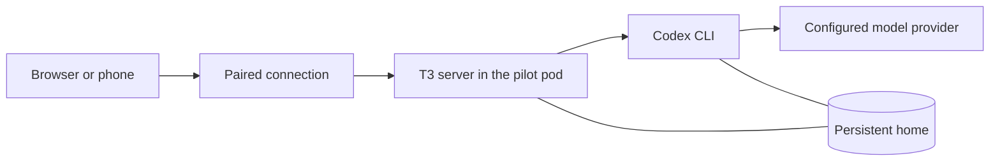

# T3 workspace on Kubernetes

Start a Factory chat from a browser and return to it from another device.
One Kubernetes pod runs T3 Code and the Codex CLI. All chats in this pilot
share the same Unix user and filesystem. Give access only to the workspace
owner. The persistent volume holds the checkouts, chat history and any
provider or device credentials you authorize.



## Prepare the workspace

1. Build the image on a machine matching the cluster architecture. Make it
   available to the nodes through your registry or a local image import.

   ```sh
   docker build -t factory-t3-pilot:0.1.13 sandbox/t3-workspace
   ```

2. Render the manifests with `kubectl kustomize sandbox/t3-workspace`. To use a
   registry image, add a Kustomize overlay with an `images` entry for
   `factory-t3-pilot`. Review the namespace, default storage class, volume size,
   and resource limits. Apply the rendered resources through the cluster
   owner's deployment workflow. The manifests create a dedicated namespace,
   one replica, one claim, a ClusterIP service and a network policy. The
   cluster network plugin must enforce NetworkPolicy. The pod needs DNS and
   outbound HTTPS to the chosen provider.

3. Place a clean Factory checkout in `/home/node/factory` and the selected
   project checkouts at their normal paths below it. For private repositories
   you can stream clean Git clones from your operator machine. Keep account
   tokens, local environment files and your SSH agent on the operator machine.
   Register the Factory with T3. Repeat `--track` for deeply nested project
   repositories you want in the same chat.

   ```sh
   kubectl --context "$PILOT_CONTEXT" -n factory-t3-pilot exec deploy/t3-workspace -- \
     t3 project add /home/node/factory --track /home/node/factory/projects/startups/example-app
   ```

## Open a chat

Set `PILOT_CONTEXT` to the chosen Kubernetes context. For the first connection,
keep this port-forward running on your operator machine.

```sh
kubectl --context "$PILOT_CONTEXT" -n factory-t3-pilot port-forward \
  --address 127.0.0.1 service/t3-workspace 3773:3773
```

In a second private terminal, request a one-time pairing link and open it in
your browser. Anyone holding an unused link can pair during its validity.

```sh
kubectl --context "$PILOT_CONTEXT" -n factory-t3-pilot exec deploy/t3-workspace -- \
  t3 auth pairing create --ttl 5m --base-url http://127.0.0.1:3773
```

For a live Codex response, sign in with your chosen account inside the pod.
The device flow shows a code in your own terminal.

```sh
kubectl --context "$PILOT_CONTEXT" -n factory-t3-pilot exec -it deploy/t3-workspace -- \
  codex login --device-auth
```

For access while your operator machine is off, pair over an existing private
network or use [T3 Connect](https://github.com/pingdotgg/t3code/blob/v0.1.13/docs/user/remote-access.md).
For Connect, run `t3 connect link --headless` inside the pod, authorize the
environment, and restart the pilot Deployment to pick up the link. Sign in
to the same T3 account on the other device. The default service has no public
ingress. A replacement pod mounts the same claim; deleting the namespace
also deletes the claim and can erase the workspace.

## Verify a build without a provider account

The smoke test exercises the real T3 and Codex executables with a local
stand-in for the model endpoint. It checks an unauthenticated request, sends
two turns across a server restart and verifies the saved conversation.
Run it on a workstation so its second T3 process has its own memory budget.

```sh
docker run --rm -i --entrypoint node factory-t3-pilot:0.1.13 \
  --input-type=module < sandbox/t3-workspace/tests/session-smoke.mjs
```
