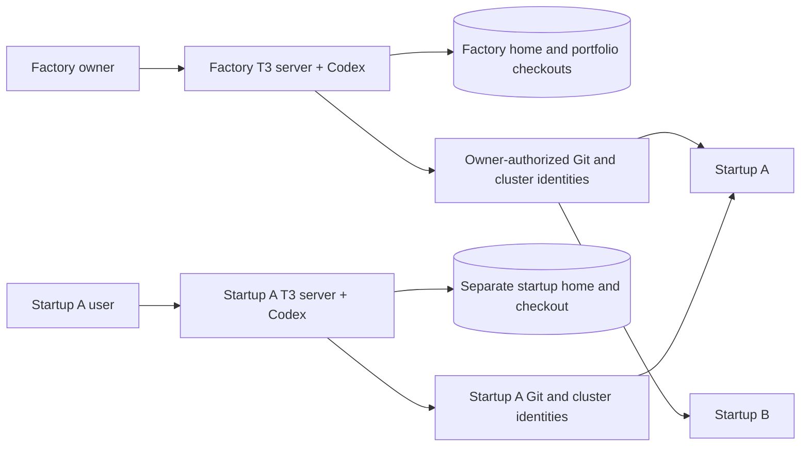

# T3 workspace on Kubernetes

Start a Factory chat from a browser and return to it from another device.
Each workspace runs a T3 server and the Codex CLI. The **Factory workspace**
holds the owner's portfolio checkout and authorized tools. Give each startup
its own workspace for its repository and credentials. Every chat paired to
one T3 server can use its filesystem and tool identities. Use a separate
namespace, persistent home, service account and pairing for each startup.
The home also persists chat history and provider sign-ins.



## Prepare the workspace

1. Build the image on a machine matching the cluster architecture. Make it
   available to the nodes through your registry or a local image import.

   ```sh
   docker buildx bake -f sandbox/t3-workspace/docker-bake.hcl --load
   ```

2. Render the manifests with `kubectl kustomize sandbox/t3-workspace`. To use a
   registry image, add a Kustomize overlay with an `images` entry for
   `factory-t3-pilot`. Review the namespace, default storage class, volume size,
   and resource limits. Apply the rendered resources through the cluster
   owner's deployment workflow. The manifests create a dedicated namespace,
   one replica, one claim, a ClusterIP service and a network policy. The
   cluster network plugin must enforce NetworkPolicy. The pod needs DNS and
   outbound HTTPS to the chosen provider.

   For a startup, use `sandbox/t3-workspace/profiles/startup` and select a
   fresh namespace. Keep the Factory PVC in its original namespace.
   [Workspace access](access/README.md) includes a runnable overlay, namespace
   grants, additional clusters and repository-scoped tool credentials.

3. Place a clean Factory checkout in `/home/node/factory` and the selected
   project checkouts at their normal paths below it. For private repositories
   you can stream clean Git clones from your operator machine. Keep account
   tokens, local environment files and your SSH agent on the operator machine.
   In **each terminal**, set `PILOT_CONTEXT` to the hosting context and
   `WORKSPACE_NS` to the exact workspace namespace. The existing Factory uses
   `factory-t3-pilot`. For a startup, use that startup’s own namespace.
   Register the Factory with T3. Repeat `--track` for deeply nested project
   repositories you want in the same chat.

   The image includes the Factory's locked Startup CLI and kubectl, plus Git,
   GitHub CLI, mise, uv and yq. To populate the whole portfolio, give the Factory
   workspace an owner-authorized Git identity and run `scripts/init.sh` from
   its Factory checkout. With GitHub HTTPS authentication, run
   `gh auth setup-git` first. For registry entries using `git@github.com:`,
   map that prefix with `git config --global url.https://github.com/.insteadOf git@github.com:`.

   ```sh
   kubectl --context "${PILOT_CONTEXT:?set the pilot context}" -n "${WORKSPACE_NS:?set the workspace namespace}" exec deploy/t3-workspace -- \
     t3 project add /home/node/factory --track /home/node/factory/projects/startups/example-app
   ```

   For a startup, seed only its own Git repository at `/home/node/project`,
   with a clean remote URL. Register it using `t3 project add /home/node/project`
   in the startup pod. Keep other checkouts and owner sign-ins in the Factory.

## Open a chat

In each terminal set `LOCAL_PORT` for this workspace (for example,
`3773` for the Factory and `3774` for a startup). Use each workspace’s
port for both forwarding and pairing. Keep the forward running on your
operator machine. Use the startup namespace in every command when pairing or
signing in to a startup. Keep Factory T3 Connect account access limited
to the owner. Pair a different audience directly to its startup server or
link that server to a separate account.

```sh
kubectl --context "${PILOT_CONTEXT:?set the pilot context}" -n "${WORKSPACE_NS:?set the workspace namespace}" port-forward \
  --address 127.0.0.1 service/t3-workspace "${LOCAL_PORT:?set this workspace port}:3773"
```

In a second private terminal, request a one-time pairing link and open it in
your browser. Anyone holding an unused link can pair during its validity.

```sh
kubectl --context "${PILOT_CONTEXT:?set the pilot context}" -n "${WORKSPACE_NS:?set the workspace namespace}" exec deploy/t3-workspace -- \
  t3 auth pairing create --ttl 5m --base-url "http://127.0.0.1:${LOCAL_PORT:?set this workspace port}"
```

For a live Codex response, sign in with your chosen account inside the pod.
The device flow shows a code in your own terminal.

```sh
kubectl --context "${PILOT_CONTEXT:?set the pilot context}" -n "${WORKSPACE_NS:?set the workspace namespace}" exec -it deploy/t3-workspace -- \
  codex login --device-auth
```

A replacement pod mounts the same claim. Deleting the namespace also deletes
the claim and can erase the workspace.

For [T3 Connect](https://github.com/pingdotgg/t3code/blob/v0.1.13/docs/user/remote-access.md),
configure outbound relay access for this workspace through the owner's deployment
workflow. Run `t3 connect link --headless` inside the selected workspace,
authorize its separate T3 environment and restart its Deployment. Check
`t3 connect status` before pairing another device.

## Verify a build without a provider account

The smoke test exercises the real T3 and Codex executables with a local
stand-in for the model endpoint. It checks an unauthenticated request, sends
two turns across a server restart and verifies the saved conversation.
Run it on a workstation so its second T3 process has its own memory budget.

```sh
docker run --rm -i --entrypoint node factory-t3-pilot:0.1.13-factory.1 \
  --input-type=module < sandbox/t3-workspace/tests/session-smoke.mjs
```
